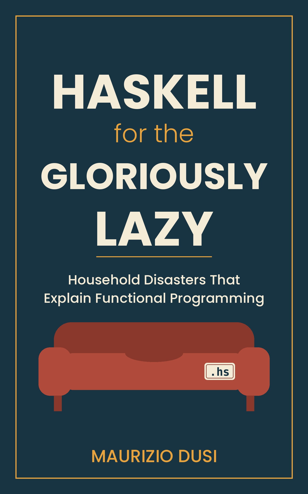

> [!TIP] **Available Now!** 
> Get your copy today from 
>  Amazon 

**You've read the Haskell tutorials. You nodded along for three chapters, hit the wall, and told yourself it would make sense later. It didn't.**

**Haskell for the Gloriously Lazy: Household Disasters That Explain Functional Programming** takes a different route. 
Its narrator is a programmer who loves his couch, his wife and, against all odds, Haskell. Every concept in the 
language, from recursion to monads, was demonstrated in his house first, badly: by a dishwasher, a coffee order, 
a neighbor who repaints borrowed lawnmowers, and a mother-in-law who visits in the spring.

Eleven episodes. No syntax lectures. A few lines of real Haskell at the end of each chapter, unexplained, for the curious. 
Not a manual. A warm-up. And, with one regrettable exception, no burritos.




This is a funny, short book for anyone who has bounced off functional programming. Instead of starting with 
syntax, each episode starts with a household disaster and lets the idea show up on its own. The dishwasher, 
the coffee order, the lawnmowers and the spring visit from the mother-in-law each stand in for a core 
Haskell idea, so by the time you meet the concept in code it already feels familiar. It's the warm-up you 
wish the tutorials had given you.



The book is organized into <b>11 short episodes</b>. Each one is a story from the narrator's home, with no 
syntax lectures along the way. At the end of every chapter you'll find a few lines of real Haskell, 
left unexplained on purpose, so the curious can poke at them while everyone else simply enjoys the story.



<ul>
  <li>Have tried <b>Haskell tutorials</b> and hit the wall around chapter three</li>
  <li>Are curious about <b>functional programming</b> but dread another dense textbook</li>
  <li>Learn best from <b>everyday analogies</b> instead of abstract definitions</li>
  <li>Love <b>programming humor</b> and stories from real life</li>
  <li>Want a quick <b>warm-up</b> before tackling a proper Haskell course or book</li>
</ul>




<ul>
    <li><b>Recursion</b>: an idea that looks strange until you see it in a household routine. </li>
    <li><b>Lazy evaluation</b>: why not doing the work until it's needed is the whole point. </li>
    <li><b>Pure functions and immutability</b>: what changes when nothing is allowed to change under your feet. </li>
    <li><b>Types and typeclasses</b>: a gentle first look at how Haskell keeps things in order. </li>
    <li><b>map, filter and fold</b>: the everyday workhorses of functional code. </li>
    <li><b>Pattern matching and Maybe</b>: handling "there might be nothing here" without drama. </li>
    <li><b>IO and monads</b>: the famously scary topic, approached through the dishwasher and the lawnmowers. </li>
</ul>





<b>Is this a Haskell tutorial?</b> 
No. It's not a manual. It's a warm-up. There are no syntax lectures, and the real Haskell at the end of each 
chapter is a few lines long and left unexplained for the curious.
  
<b>Will this teach me to write Haskell on its own?</b> 
It's designed to make the ideas feel familiar so that a proper tutorial or course is easier to follow, rather 
than to replace one.
  
<b>Which topics does the book cover?</b> 
Recursion, lazy evaluation, pure functions, immutability, types, typeclasses, map/filter/fold, pattern 
matching, Maybe, IO and monads.
  
<b>How long is it, and what format is it in?</b> 
It's about 40 pages across eleven short episodes, available as a Kindle edition on Amazon.



