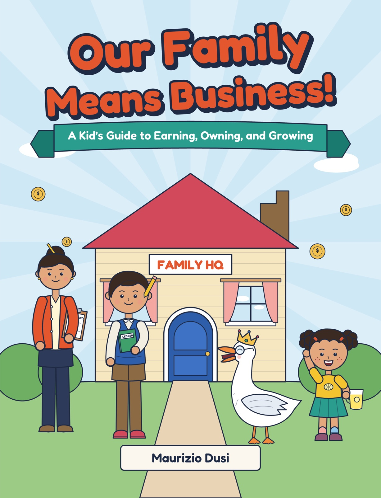

> [!TIP] **Available Now!** 
> Get your copy today from 
>  Amazon 





**Who buys the lemons?**

Zoe is launching a Lemonade Empire. Her big brother Max has questions. Where's the money coming from? Who's paying for the lemons? How much will each cup cost? Zoe's answer: "Um."

Then a goose in glasses waddles into the kitchen and announces that their family is already a company, with jobs, goals, and even a budget problem. Meet **Professor Honk**, who has one rule: *"If it isn't recorded, it didn't happen."* He tours every department of the family business, wearing a different hat in each one, and shows kids how money really works.

**Our Family Means Business!** is a hands-on workbook for kids and their parents. The best way to learn how money works is to run the company you already live in.




Our Family Means Business! is a kid's guide to earning, owning, and growing, told through a family that 
discovers it has been running a business all along. Zoe's lemonade stand raises questions her big brother 
Max can't let go of: where does the money come from, who pays for the lemons, and how much should a cup 
cost? With the help of a bespectacled goose, children learn to tell family duties from paid jobs, set a 
price a customer will say yes to, and keep track of every coin that comes in and goes out. It's written 
for parents who'd like their kids to be employees, entrepreneurs, or both.



Professor Honk is a goose in glasses with one rule: "If it isn't recorded, it didn't happen." He walks the 
family through every department of their business, wearing a different hat in each one, so children can 
see that the ordinary things their household does, like earning, spending, saving, and owing, are the same 
things every company does.



Every chapter has a <b>story</b>, <b>discussion questions</b>, a <b>kid assignment</b>, a <b>Parent Corner</b> that explains 
the real business idea, and a quick <b>online-safety tip</b>. Fifteen printable sheets turn the kitchen table 
into a boardroom: an org chart, job board, family ledger, jar labels, monthly scoreboard, balance sheet and 
more. A simple <b>three-month pacing guide</b> helps families go chapter by chapter without feeling overwhelmed.



<ul>
  <li>Are <b>homeschool families</b> or teachers looking for a hands-on money unit for the classroom</li>
  <li>Want their kids to understand <b>how money really works</b>, not just that it exists</li>
  <li>Would like their children to grow up as <b>employees, entrepreneurs, or both</b></li>
  <li>Love learning through <b>stories, discussion, and hands-on assignments</b> shared at the kitchen table</li>
  <li>Want a clear <b>pacing guide</b> so the whole family can work through it together</li>
</ul>



<ul>
    <li><b>Duties vs. paid jobs</b>: telling family chores from paid work, and setting a price a customer will say yes to. </li>
    <li><b>Keeping a ledger</b>: recording every coin that comes in and goes out. </li>
    <li><b>Reading a scoreboard</b>: using a monthly scoreboard to see profit or loss. </li>
    <li><b>Owning and owing</b>: building a balance sheet of what they own and what they owe. </li>
    <li><b>Money from what you own</b>: discovering that money can come from what you own, not only from what you do. </li>
    <li><b>Spotting marketing tricks</b>: seeing through "Everyone has one!" before they buy. </li>
</ul>




<b>Do parents need business experience to use this book?</b> 
No. Each chapter has a Parent Corner that explains the real business idea behind the story, so adults can 
guide the conversation with confidence.
  
<b>Is this a story book or a workbook?</b> 
Both. It's a hands-on workbook for kids and their parents, and every chapter opens with a story before the 
discussion questions and the kid assignment.
  
<b>Can it be used in a homeschool or classroom?</b> 
Yes. It's made for homeschool families and classrooms. Every chapter pairs a story with discussion 
questions and a hands-on kid assignment, and the three-month pacing guide and fifteen printable sheets 
keep a whole unit organized.
  
<b>How long does it take to work through?</b> 
The book includes a simple three-month pacing guide that helps families go chapter by chapter without 
feeling overwhelmed.
  
<b>What format is it, and how long is it?</b> 
It's a paperback of 90 pages.



